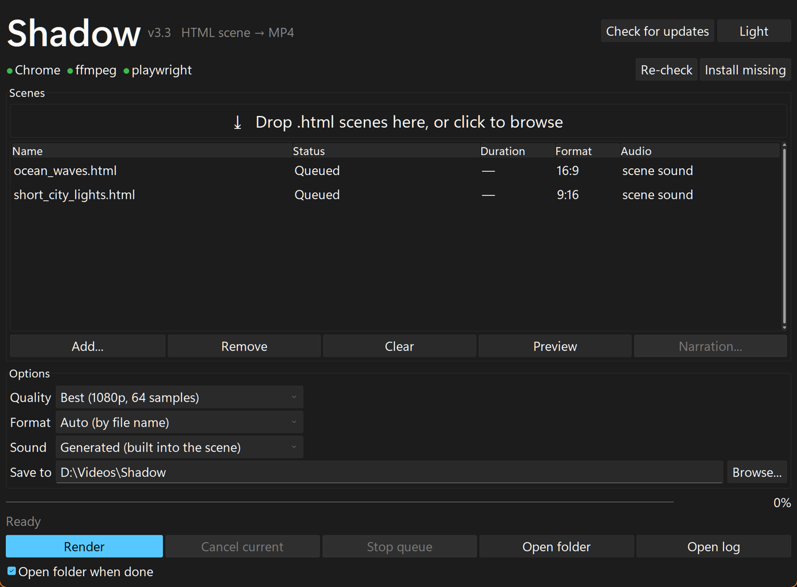

# Shadow

Free Windows app that renders self-contained **three.js / canvas HTML scenes** into **MP4 videos**
(1080p, 30 fps, with sound), 16:9 for YouTube or 9:16 for Shorts. Made for code-made motion-graphics channels:
write (or generate) a scene as one `.html` file, drop it in Shadow, get a clean, frame-exact video.

## Install

1. Download `Shadow-<version>-Setup.exe` from [Releases](../../releases/latest) and run it
   (no admin needed; Windows SmartScreen may warn because the app is not code-signed: *More info → Run anyway*).
2. The setup offers to install what is missing with winget: **Google Chrome** and **ffmpeg** (both free).
3. Start Shadow from the Desktop / Start menu. New versions show an **Update** button in the app.

## Use

Add `.html` scenes (drag and drop or *Add...*), pick quality, format (16:9, 9:16 or *Auto*: files named `short_*` render 9:16),
sound and the output folder, press **Render**. Every scene gets its own folder with the `.mp4`, a quality-check report
(`.qc.txt`: black frames, freezes, silence, loudness) and, if it failed, a log. Existing files are never overwritten.

- **Sound**: the scene's own generated sound, an external file (loudness-normalised to -15 LUFS, true-peak limited),
  *Auto* (`<scene>.wav/.mp3/...` next to the scene) or silent.
- **Narration**: a voice WAV + word timings (`words.json`) are mixed in and shown as word captions (2D canvas scenes).
- **Command line**: `Shadow.exe --render scene.html out.mp4 [--vertical] [--preset draft|good|best] [--silent]`

## Scene contract

A scene is one HTML file with:

- `<canvas id="c">`; with `?render=1` in the URL it must not autoplay
- `window.__ready = true` once loaded, `window.DURATION` (seconds)
- `window.seek(t)` draws exactly the frame at time `t` (pure function of `t`; no real-time loop, no `Math.random` - use a seeded random)
- size from the `w` and `h` URL parameters (read `h` to support 9:16)
- optional `window.STYLE_SOUND(k)` + the `SOUND.renderOffline` kit for generated sound

See `tests/fixtures/webgl_min.html` for a minimal working scene.

## Build from source

Python 3.12 on Windows: `run.bat` runs it from source, `build_exe.bat` builds `dist\Shadow.exe` (PyInstaller),
`build_installer.bat` builds the setup ([Inno Setup 6](https://jrsoftware.org/isinfo.php), free).
Tests: `python tests\regression.py`, `tests\test_queue_gui.py`, `tests\test_updater.py`, ... (`tests\smoke_test.py` runs on Linux).

Release (maintainer): double-click `publish_update.bat` (asks the new version and notes, runs the tests, builds, uploads, releases).

## License

MIT. Shadow uses Google Chrome (via Playwright) and ffmpeg, which are installed separately under their own licenses.

---

## بالعربي

**Shadow** برنامج مجاني لويندوز يحوّل مشاهد HTML (three.js أو canvas) لفيديوهات MP4 بدقة 1080p و30 إطار مع الصوت،
بصيغة 16:9 لليوتيوب أو 9:16 للشورتس.

**التنصيب:** نزّل `Shadow-<version>-Setup.exe` من [Releases](../../releases/latest) وشغّله. ما يحتاج صلاحيات أدمن.
إذا طلع تحذير SmartScreen اضغط *More info* وبعدها *Run anyway*. المنصّب يعرض ينصّب Chrome وffmpeg إذا ناقصين.
لما ينزل إصدار جديد يطلعلك زر **Update** داخل البرنامج.

**الاستخدام:** اسحب ملفات `.html` للبرنامج، اختار الجودة والصيغة والصوت ومجلد الحفظ، واضغط **Render**.
كل مشهد ينحفظ بمجلد خاص بيه، ويا الفيديو تقرير فحص جودة.
