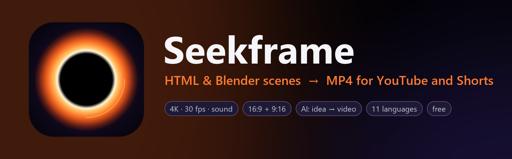
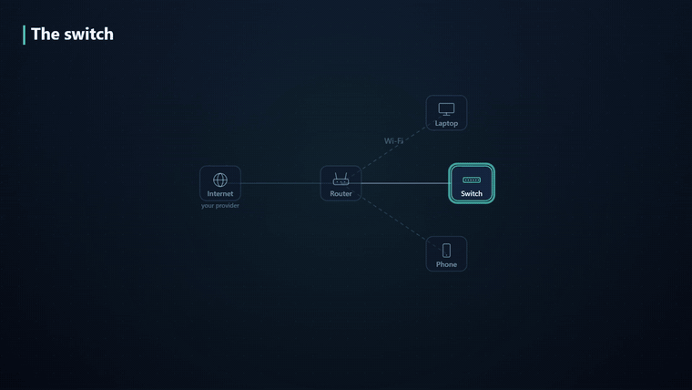
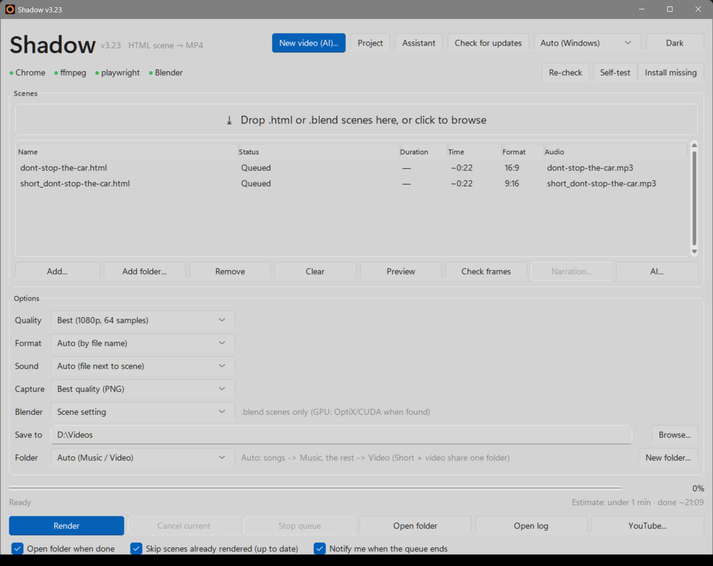
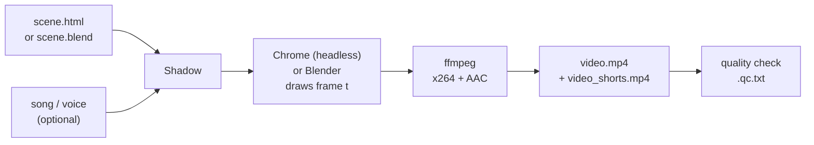

<p align="center">
  
</p>

<p align="center">
  <a href="../../releases/latest"></a>
  <a href="../../releases"></a>
  
  <a href="LICENSE"></a>
  <a href="docs/MCP.md"></a>
</p>

<p align="center">
  <b>Free Windows app that turns code-made scenes into finished videos.</b><br>
  Write (or generate) a scene as one <code>.html</code> file - or build it in Blender - drop it in Shadow,
  and get a clean, frame-exact MP4 with sound, for YouTube (16:9) and Shorts (9:16).
</p>

<p align="center">
  <a href="../../releases/latest"><b>Download</b></a> &nbsp;·&nbsp;
  <a href="#quick-start">Quick start</a> &nbsp;·&nbsp;
  <a href="#features">Features</a> &nbsp;·&nbsp;
  <a href="docs/GUIDE.md">User guide</a> &nbsp;·&nbsp;
  <a href="#use-shadow-from-claude-mcp">Claude (MCP)</a> &nbsp;·&nbsp;
  <a href="CHANGELOG.md">Changelog</a>
</p>

<p align="center">
  
  <br><sub>A narrated diagram scene rendered by Shadow: voice, word captions, motion, all from one HTML file.</sub>
</p>

## Quick start

1. **Download** `Shadow-<version>-Setup.exe` from [Releases](../../releases/latest) and run it. No admin needed.
   Windows SmartScreen may warn because the app is not code-signed: choose *More info* → *Run anyway*.
2. The setup offers to install what is missing with winget: **Google Chrome** and **ffmpeg** (both free).
3. Open Shadow, **drop your scenes** in, press **Render**. That's it.

New versions show an **Update to vX.Y** button inside the app and install themselves.

Every button, option, output file and QC check is explained in the **[user guide](docs/GUIDE.md)**.

## Features

| Feature | What it does |
|---|---|
| **Frame-exact video** | Every frame is drawn on purpose (`seek(t)`), so the video is identical every time - no dropped frames, no screen recording. |
| **1080p, 30 fps, with sound** | The scene's own generated sound, a song or voice file next to it (*Auto*), or silent. Loudness is set to about -15 LUFS and checked *after* encoding. |
| **YouTube + Shorts in one go** | *Format Auto*: files named `short_*` or `*-short` render 9:16, the rest 16:9 - one queue, both formats. |
| **Quality check on every video** | A `.qc.txt` report: size, duration, black frames, freezes, silence, loudness and true peak. |
| **Narration with captions** | Put `<scene>.wav` + `<scene>.words.json` next to the scene: the voice is mixed in and word captions appear (2D canvas scenes). |
| **Blender scenes** | `.blend` files render through your installed Blender (Eevee, Cycles on the GPU, or Workbench) with the same sound, Shorts and QC. [Guide](docs/BLENDER.md) |
| **Check before you render** | *Check frames* shows a contact sheet in both formats in seconds and lists page errors and frames that are not repeatable. |
| **Batch-friendly** | *Add folder...* (or drop a folder), *Skip scenes already rendered*, a time estimate per scene and for the whole queue, and a Windows notification when it is done. |
| **Subtitles** | A narrated video gets a `.srt` subtitle file next to it, ready to upload to YouTube. |
| **Upload to YouTube** | *YouTube...* uploads the finished videos to your channel with the title, description, tags and *Made for Kids* from `metadata.txt` (Private by default), through your own free Google Cloud project. [Guide](docs/YOUTUBE.md) |
| **Tidy output folders** | *Folder Auto* puts songs in `Music\` and everything else in `Video\`; a Short is saved next to its video. |
| **Fast or best** | *Capture*: Best quality (PNG, default) or Fast (JPEG, about 2x faster, very slightly softer). |
| **Claude can run it** | A local MCP server lets Claude render, follow progress, preview frames and read QC reports for you. Works with other MCP clients too (Gemini CLI, Cursor, VS Code, ...). [Guide](docs/MCP.md) |
| **Assistant panel** | Ask in plain words inside the app ("render this folder and check the quality") and watch Claude do it. Runs on your Claude subscription through Claude Code, no API key. [Guide](docs/ASSISTANT.md) |
| **Safe and tidy** | Each scene gets its own output folder; nothing is ever overwritten (`_2`, `_3`); failed renders leave a log. |
| **Free and offline** | No accounts, no paid services, nothing uploaded. Only your scenes' own CDN links (e.g. three.js) need the internet. |

<p align="center">
  
  
</p>

## How it works



Shadow opens each scene in your installed Chrome (or Blender), asks for one frame at a time, and pipes the frames straight
into ffmpeg while the sound is rendered and loudness-matched. Nothing depends on how fast your PC is: a slow machine just
takes longer and produces the same video.

## Make a scene

A scene is one HTML file that provides:

- `<canvas id="c">`; with `?render=1` in the URL it must not autoplay
- `window.__ready = true` once loaded, and `window.DURATION` (seconds)
- `window.seek(t)` draws exactly the frame at time `t` (a pure function of `t`: no real-time loop, no `Math.random` - use a seeded random)
- the size from the `w` and `h` URL parameters (read `h` to support 9:16)
- optional: `window.STYLE_SOUND(k)` + the `SOUND.renderOffline` kit for generated sound, `window.THUMBNAIL_T` for an automatic thumbnail

[`tests/fixtures/webgl_min.html`](tests/fixtures/webgl_min.html) is a minimal working scene. Before a long render, press
**Check frames** (or run `python tools/check_frames.py scene.html`): a contact sheet in both formats in a few seconds, and a check that `seek(t)` is pure.

**Command line:** `Shadow.exe --render scene.html out.mp4 [--vertical] [--preset draft|good|best] [--silent] [--fast]`,
`Shadow.exe --check scene.html [--only 16:9|9:16]` (contact sheet `<scene>.check.jpg` next to the scene)

## Use Shadow from Claude (MCP)

Claude (Claude Code, Claude Desktop or any MCP client) can render with Shadow for you - a scene or a whole folder - follow
the progress, cancel, preview frames and read the quality report, without opening the window. It is local and free
(no API keys, nothing leaves your PC). It runs from a copy of this repository with Python, not from the installed exe:

```
git clone https://github.com/Reemon88IQ/shadow C:\Shadow
python -m pip install "mcp>=2" playwright pillow tkinterdnd2 sv-ttk darkdetect numpy
claude mcp add shadow --scope user -- python C:\Shadow\tools\mcp_server.py
```

Then copy `claude-skills\shadow-mcp` to `%USERPROFILE%\.claude\skills\` so Claude knows when to use it, and check with
`claude mcp list` (`shadow: ... Connected`). Full guide, the tool list and setups for Claude Desktop, Cursor, VS Code,
Windsurf and Gemini CLI (plus an optional localhost-only HTTP mode): [docs/MCP.md](docs/MCP.md).

**Assistant panel:** the **Assistant** button in the window opens a chat with Claude that uses these tools. It runs on your
Claude subscription through the installed Claude Code CLI (no API key). Claude may only read files and use Shadow's tools;
stopping a render needs your click. Details and the exact permissions: [docs/ASSISTANT.md](docs/ASSISTANT.md).

## FAQ

**Windows warns "Windows protected your PC".** The installer is not code-signed (a certificate costs money). Choose
*More info* → *Run anyway*. The file on the release page has its SHA-256 listed, so you can check it was not changed.

**The top bar shows "ffmpeg (missing)" right after installing.** Sign out and in once (or restart) so Windows refreshes
the PATH, then press *Re-check*.

**Does it need a graphics card?** No. Scenes render on any PC; a GPU just makes three.js and Blender scenes faster.

**My 9:16 video looks like a squeezed 16:9.** The scene must read the `h` URL parameter and lay itself out for a tall
frame. Shadow warns before rendering a 9:16 version of a scene that does not.

**Where are my settings and logs?** Settings: `%USERPROFILE%\.shadow_renderer.json`. Log: `%USERPROFILE%\shadow.log`
(or press *Open log*). A failed render also leaves a `.log` in its output folder.

Something else? [Open an issue](../../issues/new/choose).

## Build from source

Python 3.12 on Windows: `run.bat` runs it from source, `build_exe.bat` builds `dist\Shadow.exe` (PyInstaller),
`build_installer.bat` builds the setup ([Inno Setup 6](https://jrsoftware.org/isinfo.php), free).
Tests: `python tests\regression.py`, `tests\test_queue_gui.py`, `tests\test_updater.py`, ... (`tests\smoke_test.py` runs on Linux).
Release (maintainer): double-click `publish_update.bat` (asks the new version and notes, runs the tests, builds, uploads, releases).

## License

[MIT](LICENSE) · [Privacy policy](docs/PRIVACY.md). Shadow uses Google Chrome (via Playwright), ffmpeg and, for `.blend` files, Blender - all installed
separately under their own licenses. Videos you make with Shadow are yours.
