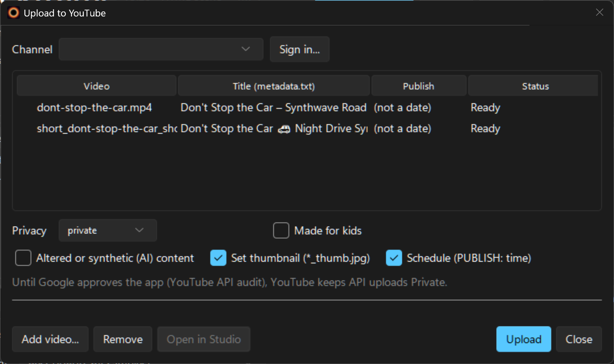

# Upload to YouTube

Seekframe can upload finished videos straight to your channel, with the title, description, tags and *Made for Kids* setting
from a `metadata.txt` file. It uses the free **YouTube Data API** with **your own** Google Cloud project, so nothing goes
through anyone else's server and your password is only ever typed on Google's own page.

> **Important:** until your Google Cloud project passes YouTube's API audit, YouTube keeps every video uploaded through the
> API **Private** (it cannot be made public later). Use it to upload private drafts, or apply for the audit (below).

## One-time setup (about 10 minutes, free)

1. Open [Google Cloud console](https://console.cloud.google.com/) and create a project (or use an existing one).
2. **APIs & Services → Library → YouTube Data API v3 → Enable.**
3. **Google Auth Platform → Get started:** app name `Seekframe`, your support email, audience **External**, your contact
   email, agree to the policy, **Create**.
4. **Audience → Test users → Add users:** the Google account(s) that own the channels you upload to.
5. **Clients → Create client → Desktop app**, name it, **Create**, then **Download JSON** and save it as
   `%USERPROFILE%\.shadow_youtube_client.json`. Keep this file private.

While the app is in *Testing*, a sign-in lasts 7 days. Publishing the app (*Audience → Publish app*; Google asks for a
homepage and a privacy policy link first) makes it last; Google then shows an "unverified app" screen at sign-in until
the app is verified - choose *Advanced → Go to Seekframe*.

## Use it



1. Render your scenes as usual.
2. Press **YouTube...** (next to *Open log*). The dialog lists the videos you just rendered for the selected rows (or all
   rows). **Add video...** picks any other mp4.
3. **Sign in...** once per channel: Google's page opens in your browser, you pick the account and allow *upload videos* and
   *see your channel*. Seekframe keeps only a refresh token in `%USERPROFILE%\.shadow_youtube_tokens.json`.
4. Choose the channel, check the titles, press **Upload**. Privacy is **Private** by default. Double-click a finished row
   (or **Open in Studio**) to check it in YouTube Studio, then schedule or publish it there.
5. Checkboxes: **Altered or synthetic (AI) content** (set from `AI:` in metadata.txt), **Set thumbnail** and **Schedule**
   (the *Publish* column shows the `PUBLISH:` time in your PC's time zone; a time already past uploads without a schedule).
   A thumbnail YouTube refuses (custom thumbnails need a [verified channel](https://www.youtube.com/verify)) never stops the upload:
   the row says *no thumbnail* and why.

To remove Seekframe's access: [myaccount.google.com/permissions](https://myaccount.google.com/permissions) → Seekframe → Remove.

## metadata.txt

Put it next to the video or next to the scene. A `=== ... SHORT ... ===` section is used for `*_shorts.mp4`, any other
`=== ... ===` section (or a file without sections) for the normal video:

```
=== FULL VIDEO ===
TITLE: Don't Stop the Car – Synthwave Road Trip Song
DESCRIPTION:
Windows down, the night is ours.

0:00 Intro
0:16 Verse 1
TAGS: synthwave, road trip song, night drive music
AUDIENCE: Made for Kids = NO

=== SHORT ===
TITLE: Don't Stop the Car #shorts
DESCRIPTION:
The chorus - full song on the channel.
TAGS: synthwave, shorts
AUDIENCE: Made for Kids = NO
```

Optional fields:

| Field | What it does |
|---|---|
| `CATEGORY:` | music, education, science, entertainment, film or a number (default music) |
| `PRIVACY:` | private, unlisted or public |
| `AI: yes` / `AI: no` | YouTube's *altered or synthetic content* label (`status.containsSyntheticMedia`). Without it the dialog's checkbox decides (off by default) |
| `THUMBNAIL: cover.jpg` | the thumbnail image, relative to metadata.txt (JPG/PNG, up to 2 MB). Without it Seekframe uses `<video>_thumb.jpg` next to the video (saved when the scene sets `window.THUMBNAIL_T`). Shorts get one only from this field |
| `PUBLISH:` | schedules the video when it holds a date **and** a time: `Thu 19 Nov 2026, 5:00 AM Sydney time`, `2026-11-25 05:00`, `2026-11-25T05:00+11:00`, `19 Nov 2026 9 pm UTC`. Zone words: Sydney, Melbourne, Baghdad, London, New York, UTC; none = this PC's zone. A Short's `PUBLISH: same time as the full video` takes the full video's time. Text without a date (`5:00 AM Sydney time`) is ignored, shown as *(not a date)* |

Without a metadata.txt the title is made from the file name.
YouTube's limits are applied: title 100 characters, description 5000 bytes, tags 500 characters.

## From Claude (MCP)

Claude can upload through Seekframe's MCP server ([MCP.md](MCP.md)): `shadow_upload_preview` shows what would be sent,
and `shadow_upload` uploads it after you say yes. In the Assistant panel the upload always asks for **Allow once**.

## Command line

```
python youtube.py signin
python youtube.py channels
python youtube.py upload "D:\Videos\Music\song\song.mp4" --meta metadata.txt --channel "Moon Shift" --privacy private
python youtube.py upload song.mp4 --ai yes --thumbnail cover.jpg --publish "2026-11-25 05:00 Sydney"
```

## The API audit (to upload public videos)

Apply with Google's [YouTube API Services audit and quota extension form](https://support.google.com/youtube/contact/yt_api_form),
with a short screen recording of the sign-in and an upload. Until it is approved, uploads stay Private - a scheduled video
then stays Private at its time too.

## Quota

The API has a free daily quota (10,000 units by default); an upload costs about 1,600 units, so roughly 6 uploads a day; setting a thumbnail costs 50 more.

## Privacy

What Seekframe stores and sends: [PRIVACY.md](PRIVACY.md).
